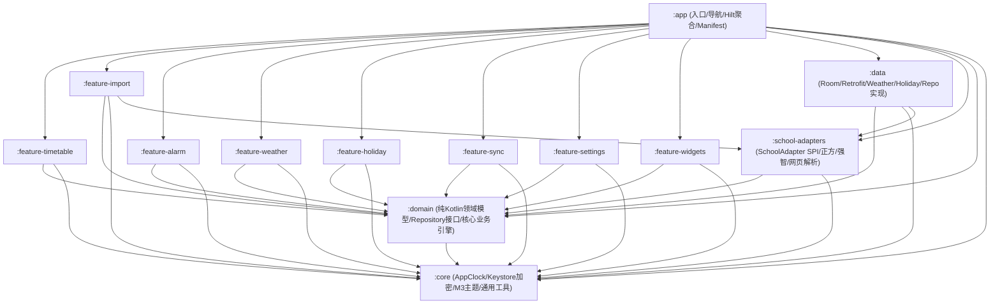

# 桃课 · 智能校园课表 — 系统技术架构设计（v2.2.0）

## 1. 产品定位与设计原则

- **目标用户**：中国大陆普通本科院校、高职院校在校学生。
- **核心原则**：本地优先（Offline-First）、功能真实性优先（绝不使用假接口或静态假数据冒充功能）、隐私安全合规（绝不保存或上传教务密码、绝不绕过验证码与身份认证）。
- **版本范围**：专注八大核心模块（课表管理、多校教务与文件导入、智能闹钟、体育课天气提醒、法定节假日与校历、账号与云同步、桌面小组件、系统设置），不引入无关的成绩/论坛/社交模块。

## 2. 技术栈选型

### Android 客户端（原生 Kotlin + Compose）
- **最低/目标版本**：`minSdk = 26` (Android 8.0)，`targetSdk = 35` / `compileSdk = 35`
- **UI 层**：Jetpack Compose + Material Design 3 + Navigation Compose + Jetpack Glance（4 种原生桌面小组件）
- **架构模式**：Clean Architecture + MVVM + 单向数据流（StateFlow）+ 13 模块解耦工程
- **数据层**：Room 2.6（本地 **15 张表**主存储 + Schema v2 导出 + `MIGRATION_1_2`）、DataStore Preferences（主题/轻量设置）、Android Keystore AES-256-GCM（敏感会话加密）
- **网络与序列化**：Retrofit 2.11 + OkHttp 4.12 + Kotlinx Serialization 1.7
- **调度与后台**：AlarmManager（精确上课/下课闹钟 + 无精确权限时降级提醒）+ WorkManager（天气检查、节假日同步、云端自动备份）。**v2 已删除 TextToSpeech 语音播报**
- **作息与假期引擎**：`BellScheduleRuleEngine`（统一规则推算整天节次、单节差异、自定义课间、按星期覆盖、模板）+ `HolidayMergeEngine`（连续假期区间合并与单条提醒）
- **天气来源策略**：仅使用真实公开气象接口 —— Open-Meteo（默认）与和风天气 QWeather（可选）；**v2.1.0 已删除手机系统/厂商天气入口与探测代码**。内置 `ChinaCityPresets.kt` 收录 2154 座城市（地级市、地区/自治州首府、县级市与县城区），支持离线即时筛选与联网检索
- **学校目录**：内置 `assets/schools_catalog_v2.json`（教育部 2741 所大陆高校，含示例树维高校（如清华大学等试点样例））+ `GET /api/v1/schools/catalog` 远程热更新 + 本地 Room 全量缓存与拼音/首字母/省份检索
- **文件解析与 OCR**：
  - `.xls`：Apache POI (`org.apache.poi:poi:4.1.2`，避免 Log4j2 `StackWalker` 在 Android 8–13 的兼容性崩溃）
  - `.xlsx`：基于 Android 原生 `ZipInputStream` + `DocumentBuilderFactory` 的 OOXML 完整解析器（支持共享字符串、内联字符串、多 Sheet 与合并单元格，避免 `poi-ooxml` 引入 `javax.xml.stream` 崩溃及包体暴涨）
  - `.pdf`：PDFBox-Android 2.0.27（提取真实文本并渲染扫描件页面为 `Bitmap`）
  - 扫描版 PDF OCR：Google ML Kit 本地中文+英文文字识别（`text-recognition-chinese`）
  - 网页课表解析：Jsoup 1.18 + 受控 WebView 辅助登录（用户自行完成学校官方登录与验证码，绝不窃取密码）；v2.2.0 增加该校教务处直达地址表（`school_academic_urls.json`，仅收录公开访问校验通过的页面）、返回键网页回退、弹窗兼容与「浏览器打开」系统浏览器跳转

### 后端服务（Spring Boot）
- **运行时与框架**：Java 17 + Spring Boot 3.4 + Spring Web + Spring Data JPA + Spring Security + Flyway
- **数据存储**：PostgreSQL 16（生产主库）+ 可选 Redis 7（短信验证码限流与缓存）+ H2（自动化集成测试）
- **身份认证**：手机号 + 短信验证码 + JWT（Access Token + Refresh Token）；短信服务采用可替换 `SmsProvider` 接口（阿里云 SMS 适配器 + 仅 `dev` 环境可用的日志验证码适配器，`prod` 环境强制禁止测试后门）
- **部署**：Docker + Docker Compose + `.env.example`

## 3. 模块依赖拓扑（无环 DAG）

### 跨模块解耦设计
- 所有 `feature-*` 模块**禁止互相依赖**，也**禁止直接依赖 `:data`**，仅依赖 `:domain` 与 `:core`（`:feature-import` 额外依赖 `:school-adapters`）。
- 跨功能联动（如修改课程后刷新 4 个桌面小组件、重新调度课程闹钟、重算体育课天气提醒）通过 `:domain` 定义的端口接口 `AlarmSchedulerPort`、`WidgetRefresherPort`、`WeatherSchedulerPort` 解耦，在 `:app` 层由 Hilt 绑定具体实现。
- 时间依赖统一通过 `:core` 的 `AppClock` 抽象注入，保障单元测试可使用可控模拟日期（如特定周次、节假日、体育课前一天、调休工作日）进行严格验证。
