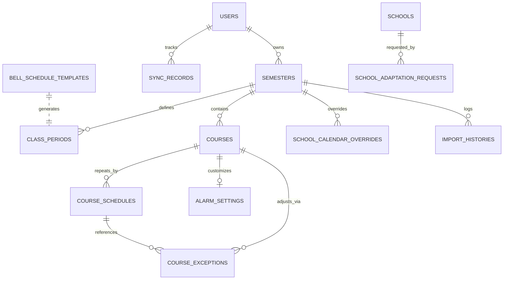

# 数据库设计文档（Android Room & 服务端 PostgreSQL）

本系统采用**本地优先（Local-First）**的数据架构，Android 端通过 Room 维护 **15 个核心实体（Schema v2）**，服务端通过 PostgreSQL + Flyway 维护云同步与共享基础数据（法定节假日、学校目录、学校适配申请、用户云备份）。

> v2.0.0 变更：新增 `bell_schedule_templates`（作息模板）与 `school_adaptation_requests`（学校适配申请）；`holidays` 由「逐日事件」升级为「连续假期区间事件」（新增 `endDate` / `totalDays` / `reminderDate`）；`alarm_settings` 删除 `enableTts` / `ttsTemplate`；Room 版本 `1 → 2`，提供无损 `MIGRATION_1_2`，导出 Schema 为 `data/schemas/.../2.json`。备份包 schemaVersion 提升至 2（导入端兼容 v1–v3）。

## 1. 核心 15 个数据实体（Room Schema v2）

| 序号 | 实体类 | 表名 | 主键 | 关键字段与约束说明 |
|---|---|---|---|---|
| 1 | `UserEntity` | `users` | `id` (UUID) | `phone`（游客为空）、`nickname`、`isGuest`、`syncVersion`、`createdAt`、`updatedAt` |
| 2 | `SemesterEntity` | `semesters` | `id` (UUID) | `userId` (索引)、`name`、`startDate` (ISO `YYYY-MM-DD`)、`totalWeeks`、`periodsPerDay`、`isCurrent`、`syncVersion`、`isDeleted` |
| 3 | `ClassPeriodEntity` | `class_periods` | `id` (UUID) | `semesterId` (FK→`semesters`, 级联删除)、`dayOfWeek` (`0`=全周通用, `1..7`=按星期覆盖)、`periodNumber`、`startTime` (`HH:mm`)、`endTime` (`HH:mm`)；唯一索引 `(semesterId, dayOfWeek, periodNumber)` |
| 4 | `BellScheduleTemplateEntity` | `bell_schedule_templates` | `id` | **v2 新增**：`name`、`category`（NORMAL/SUMMER/WINTER/WEEKEND/CUSTOM）、`ruleJson`（首节时间、课时、小课间、大课间、每 N 节大课间、上午结束节次、午休、下午/晚间固定开始、总节数、单节差异时长、自定义节间休息）、`isPreset`、`updatedAt` |
| 5 | `CourseEntity` | `courses` | `id` (UUID) | `semesterId` (FK→`semesters`)、`name`、`teacher`、`location`、`courseType` (`NORMAL` / `PHYSICAL_EDUCATION`)、`colorHex`、`isAutoDetectedPe`、`syncVersion`、`isDeleted` |
| 6 | `CourseScheduleEntity` | `course_schedules` | `id` (UUID) | `courseId` (FK→`courses`, 级联删除)、`dayOfWeek` (`1..7`)、`startPeriod`、`endPeriod`、`weekRuleType` (`ALL`/`ODD`/`EVEN`/`CUSTOM`)、`startWeek`、`endWeek`、`customWeeksJson`、`teacherOverride`、`locationOverride`、`isDeleted` |
| 7 | `CourseExceptionEntity` | `course_exceptions` | `id` (UUID) | `courseId` (FK→`courses`)、`scheduleId` (FK→`course_schedules`)、`exceptionType` (`RESCHEDULE`/`CANCEL`/`MODIFY_LOCATION`/`MODIFY_TEACHER`)、`originalDate`、`originalWeek`、`targetDate`、`targetDayOfWeek`、`targetStartPeriod`、`targetEndPeriod`、`newLocation`、`newTeacher`、`reason`、`isDeleted`；**独立保存临时调课/停课，绝不破坏原始课程规则** |
| 8 | `HolidayEntity` | `holidays` | `id` | `year` (索引)、`date` (假期开始)、**`endDate`（假期结束，v2 新增）**、**`totalDays`（总天数）**、`name`、`holidayType` (`LEGAL_HOLIDAY`/`STATUTORY_WORKDAY`)、`isOffDay`、`source`、`version`、**`reminderDate`（每个连续假期仅一条节前提醒）**、`updatedAt`；**一个连续假期 = 一条记录** |
| 9 | `SchoolCalendarOverrideEntity` | `school_calendar_overrides` | `id` (UUID) | `semesterId` (FK→`semesters`)、`date`、`overrideType` (`HOLIDAY`/`NORMAL_CLASS`/`MAKEUP_CLASS`/`SUSPENDED`)、`mappedDayOfWeek`（调课映射星期）、`mappedWeekNumber`、`title`、`note`、`enableAlarmOverride`（节假日照常上课时恢复闹钟）；索引 `(semesterId, date)` |
| 10 | `AlarmSettingEntity` | `alarm_settings` | `id` (UUID) | `scopeType` (`GLOBAL`/`COURSE`)、`courseId` (可空)、`enabled`、`mode` (`NOTIFICATION`/`ALARM_CLOCK`)、`advanceMinutes`、`enableClassEndReminder`、`ringtoneUri`、`vibrate`、`muteDate`（一键关闭当日提醒）；**v2 已删除 `enableTts` / `ttsTemplate`** |
| 11 | `WeatherSettingEntity` | `weather_settings` | `id` (`"default"`) | `provider` (`OPEN_METEO`/`QWEATHER`；v2.1.0 删除 `SYSTEM_VENDOR`，旧值读取时回落 `OPEN_METEO`)、`locationMode` (`AUTO`/`MANUAL`)、`cityName`、`cityId`、`latitude`、`longitude`、`enablePeWeatherReminder`、`prevDayNotifyHour`、`prevDayNotifyMinute`、`sameDayAdvanceMinutes`、`highTempThresholdC`、`lowTempThresholdC`、`aqiThreshold`、`remindRain`、`remindSnow`、`remindThunder`、`lastWeatherJson`、`lastUpdatedAt` |
| 12 | `SchoolEntity` | `schools` | `id` | `code` (唯一索引)、`name`、`shortName`、`aliases`、`pinyin`、`pinyinInitials`、`province`、`city`、`schoolType`、`campuses`、`schoolLevel` (`UNDERGRADUATE`/`VOCATIONAL`)、`systemType` (`ZHENGFANG`/`QIANGZHI`/**`NEW_URP`**/**`OLD_URP`**/`CUSTOM`/`UNKNOWN`)、`systemVersion`、`adapterId`、`portalUrl`、`supportStatus`（VERIFIED / GENERIC_ADAPTER / ASSISTED_LOGIN / UNSUPPORTED / LAST_VERIFY_FAILED）、`verified`（仅实网验证通过的学校为 `true`）、`lastVerifiedAt`、`statusNote`；预置教育部 2741 所大陆高校 |
| 13 | `SchoolAdaptationRequestEntity` | `school_adaptation_requests` | `id` | **v2 新增**：`schoolName`、`eduSystemType`、`portalUrl`、`pageSummary`、`userAuthorized`（必须为 true）、`status`（LOCAL_SAVED / SUBMITTED_TO_SERVER）、`createdAt`；**严禁存储任何教务密码** |
| 14 | `ImportHistoryEntity` | `import_histories` | `id` (UUID) | `semesterId`、`sourceType` (`SCHOOL_ADAPTER`/`EXCEL`/`PDF`/`PDF_OCR`/`WEB_LINK`/`BACKUP_FILE`)、`sourceName`、`schoolCode`、`totalParsed`、`importedCount`、`conflictCount`、`status`、`errorMessage`、`createdAt` |
| 15 | `SyncRecordEntity` | `sync_records` | `id` (UUID) | `userId`、`deviceId`、`direction` (`PUSH`/`PULL`/`MERGE`/`BACKUP_EXPORT`/`BACKUP_IMPORT`)、`status` (`SUCCESS`/`CONFLICT`/`FAILED`)、`localVersion`、`remoteVersion`、`syncedEntitiesCount`、`conflictSummary`、`errorMessage`、`syncedAt` |

## 2. 实体关系图（ER Diagram）

## 3. Room 迁移说明（v1 → v2）

`MIGRATION_1_2` 在 `CampusDatabase.kt` 中实现：

1. 新建 `holidays_v2`（含 `endDate`/`totalDays`/`reminderDate`），把旧表每条单日记录迁移为 `endDate = date`、`totalDays = 1`、`reminderDate = NULL`，随后替换旧表 —— **不丢失任何历史节假日数据**。
2. 新建 `bell_schedule_templates`、`school_adaptation_requests` 两张表。
3. `schools` 表补齐 v2 字段（简称/别名/拼音/拼音首字母/办学类型/校区/系统版本/支持状态/最后验证时间）。
4. 首次启动时若学校目录少于 500 条，自动装载 `assets/schools_catalog_v2.json` 的 2741 所目录。

该迁移由 `data/src/test/java/.../local/CampusDatabaseMigrationTest.kt` 使用 `MigrationTestHelper` 实测验证：按导出的 `1.json` 创建 v1 库并写入用户、学期、课程、节假日、闹钟与学校样本数据，执行 `MIGRATION_1_2` 后对照 `2.json` 校验全部表结构与索引，并断言课程原样保留、节假日升级为区间记录、闹钟保留且 TTS 列已移除、新增表已创建。`schemas/` 目录通过 `data/build.gradle.kts` 挂载为测试 assets。

## 4. 服务端 PostgreSQL（Flyway）

| 迁移 | 内容 |
|---|---|
| `V1__init_schema.sql` | 用户、短信验证码、同步快照、同步审计、节假日、学校等基础表 |
| `V2__seed_school_catalog.sql` | 通用教务框架样本学校（全部 `verified = FALSE`） |
| `V3__school_adaptation_requests.sql` | **v2 新增**：学校适配申请表 `school_adaptation_requests`（`school_name`、`edu_system_type`、`portal_url`、`page_summary`、`user_authorized`、`status`、`created_at`，含索引） |

服务端 `schools_catalog_v2.json` 随 JAR 打包，通过 `GET /api/v1/schools/catalog` 下发；适配申请通过 `POST /api/v1/schools/adapt-requests` 受理，服务端强制校验 `userAuthorized=true` 并拒绝任何含 `password=`/`passwd=` 的提交。

## 5. 安全与同步原则

1. **教务系统凭据绝不入库明文、绝不入云同步**：`SyncSnapshot` 与备份 JSON 严格排除教务会话 Cookie 及账号密码；本地如需短期保留教务会话，仅存入 `KeystoreCryptoManager`（Android Keystore AES-256-GCM）并支持一键清除。
2. **临时调课/停课不可逆破坏防护**：所有单次调课、停课、换教室、代课记录独立存入 `course_exceptions`，渲染周课表与计算冲突时由领域引擎按日期实时合成；**应用新作息规则时同样不覆盖任何临时调课**。
3. **软删除与版本同步**：可同步核心表携带 `isDeleted` 与 `updatedAt` / `syncVersion`，保障游客数据合并及多设备冲突检测准确无损。
4. **假期区间完整性**：连续假期只保存一条区间记录并只生成一条提醒，避免逐日重复提醒。
